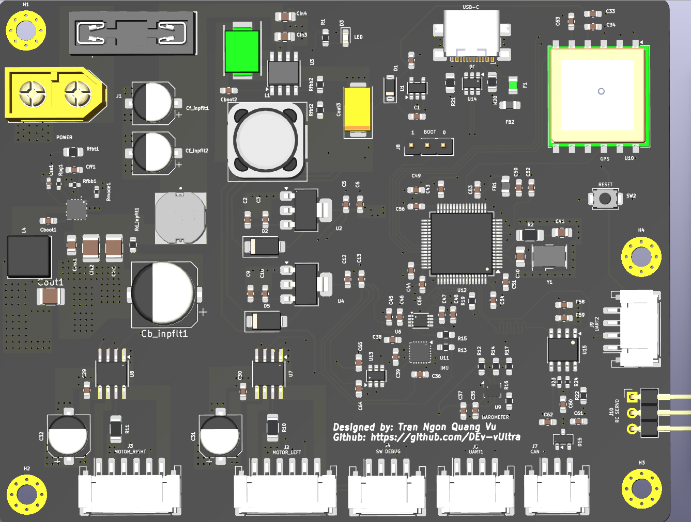
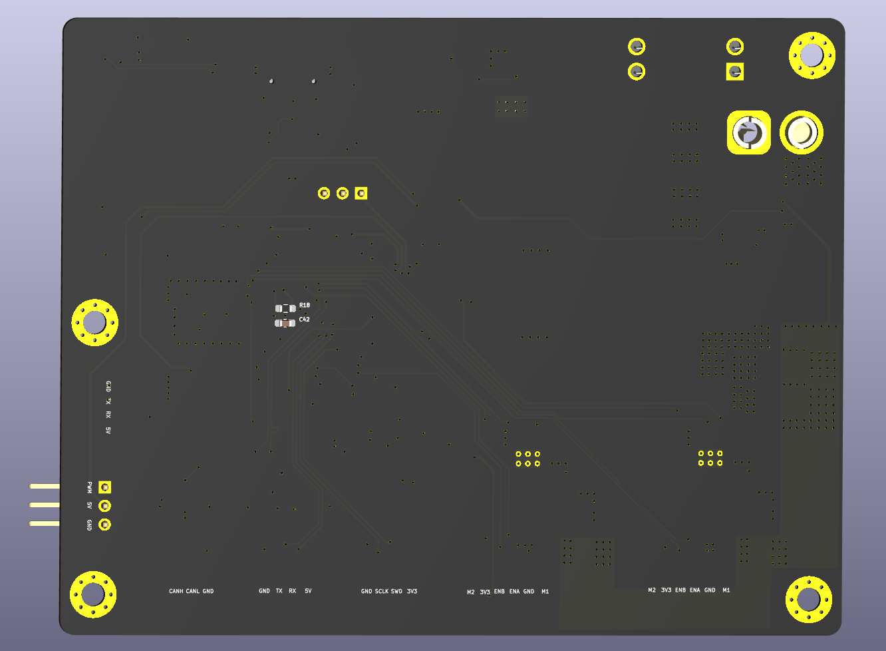

# Mobile Controller

An STM32F405-based controller board for mobile robots. It combines the MCU, an IMU, a barometer, GPS, CAN, USB and two H-bridge motor drivers with encoder inputs on a single KiCad 10 board, with the goal of making sensor timing, power noise and motor current measurable and repeatable rather than dependent on loose modules and jumper wires.





## Goals

- One reproducible board for ground robots (two-wheel balancing robot, wheel-legged robot, rovers).
- A ground test bench for state estimation (ESKF using IMU + GPS + barometer) before moving the same algorithms to a UAV.
- Firmware written to **MISRA-C** and **NASA Power of Ten** rules, with hardware that supports fault detection and graceful degradation.

## Features

| Block | Part | Notes |
|---|---|---|
| MCU | STM32F405RGT6 (LQFP-64) | 8 MHz HSE crystal, SWD, BOOT0 jumper |
| IMU | ICM-20948 | I2C, address `0x68` (AD0 = GND), 1.8 V domain with level shifting |
| Barometer | BMP280 | I2C, address `0x76` (SDO = GND), separate I2C bus |
| GPS | Quectel L80-R | UART, 1PPS and RESET broken out, backup supply from a coin cell via Schottky OR-ing |
| Motor drivers | 2 × DRV8870 | One per side, 0.2 Ω sense resistor, PWM pair on the same timer |
| Encoders | 2 × quadrature inputs | On the motor connectors (ENA/ENB, 3V3) |
| CAN | SN65HVD230 | Split termination, TVS protection, high-frequency EMI filter |
| USB | USB-C 2.0 full speed | ESD protection (USBLC6-2SC6); also used for DFU boot |
| RC servo | 1 channel | 3.3 V PWM level-shifted to 5 V |
| UART connectors | Telemetry, RC control | 4-pin; the RC control connector is intended for a 24 GHz mmWave sensor (C4001) |
| User I/O | LED, RESET button, BOOT jumper | |

## Power architecture

```
Battery ──► Fuse ──► Reverse-polarity Schottky ──► VIN
                                                    │
                       ┌────────────────────────────┤
                       ▼                            ▼
               TPS5430 buck (5 V)          TPS56A37 buck (12 V motor rail)
                       │                            │
        ┌──────────────┼──────────────┐             ▼
        ▼              ▼              ▼       2 × DRV8870
  AMS1117-3.3    AP2112K-3.3     AMS1117-1.8    (left / right)
  (MCU, sensors)    (GPS)           (IMU)
```

- **Input voltage range:** _TODO: fill in after checking the maximum VIN of every regulator and the intended battery._
- Separate LDOs for the GPS and the IMU reduce noise coupling from the rest of the digital rail.
- 5 V is also used for the RC servo, telemetry and USB-side peripherals.

## Interfaces and connectors

| Ref | Label | Signals |
|---|---|---|
| J1 | POWER | Battery input |
| J2 | MOTOR_LEFT | M1, M2, GND, 3V3, ENA, ENB |
| J3 | MOTOR_RIGHT | M1, M2, GND, 3V3, ENA, ENB |
| J4 | SW DEBUG | SWDIO, SWCLK, GND, 3V3 |
| J5 | Telemetry | 5V, TX, RX, GND |
| J6 | USB-C | USB 2.0 FS |
| J7 | CAN | CANH, CANL, GND |
| J8 | BOOT | BOOT0 selection jumper |
| J9 | RC control | 5V, TX, RX, GND |
| J10 | RC servo | PWM, 5V, GND |

> _TODO: add a table mapping each interface to its STM32 pin and peripheral (USARTx, I2Cx, TIMx) from the schematic._

## Design notes

- **BOOT0:** jumper to 3V3 boots from system memory (USB DFU / STM32CubeProgrammer); jumper to GND boots from flash (ST-Link / STM32CubeIDE). A 10 kΩ resistor limits current and avoids a floating pin while the jumper is moved.
- **Reset:** pull-up plus capacitor to filter noise and delay release, so the MCU does not reboot from spurious glitches.
- **Crystal:** load capacitors computed from `CL - CStray = (C1·C2)/(C1+C2)`; the external resistor and gain margin (> 5) were checked against the crystal datasheet.
- **IMU level shifting:** a TXS0102 translator is used between the 1.8 V IMU and the 3.3 V MCU instead of a discrete BSS138 stage, because of lower parasitic capacitance, higher open-drain speed and internal pull-ups. Keep these traces short to avoid ringing.
- **Motor drivers:** DRV8870 speed control uses PWM between drive and brake, so both PWM GPIOs for a motor must be on the same timer.
- **CAN:** TVS diode on CANH/CANL, 100 pF filter capacitors, and split termination with a 47 nF capacitor.
- **GPS:** 1PPS (100 ms pulse on the rising edge) can be used to time-stamp GPS data; RESET is connected so the module can be reset from firmware.


## Getting started

1. **Power:** connect the battery to J1 with correct polarity. Verify the 5 V, 3.3 V, 1.8 V and motor rails before connecting motors.
2. **Flash:** connect an ST-Link to J4 (BOOT jumper to GND), or put the jumper on 3V3 and use USB DFU.
3. **Motors:** connect motors and encoders to J2/J3.
4. **Telemetry:** connect a USB-UART adapter or RF module to J5.


## Author

Tran Ngon Quang Vu — [github.com/DEv-vUltra](https://github.com/DEv-vUltra)


_TODO: choose a license for hardware (for example CERN-OHL-P or CERN-OHL-S) and software (for example MIT or Apache-2.0)._
